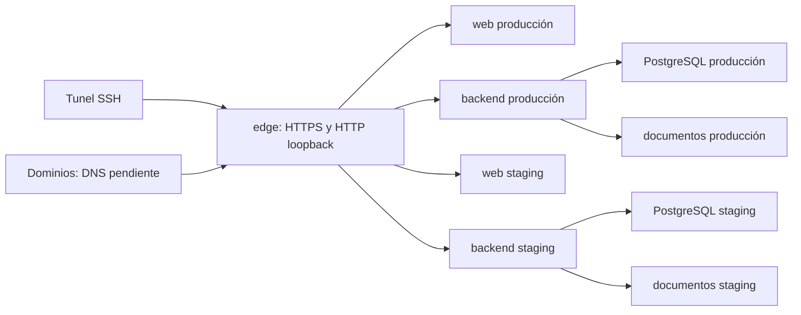

# Despliegue de Exotic en la VM

Estado al **5 de noviembre de 2026**: produccion y staging activos en la VM,
inicializados desde una misma copia de Render produccion. Seis servicios
saludables y proxy compartido operativo, siete contenedores en total. Acceso
SSH conservado y cuatro subdominios configurados; DNS y certificados publicos
pendientes. Falta confirmar que la IP de Google Cloud este reservada.
El registro operativo está en [DESPLIEGUE_INICIAL.md](docs/DESPLIEGUE_INICIAL.md).
La preparacion de los cuatro nombres publicos y la entrega para el administrador
DNS estan en [SUBDOMINIOS.md](docs/SUBDOMINIOS.md).
El acceso HTTPS adicional por IP mediante `/prod/` y `/staging/` esta activo
y verificado con certificado publico. Su funcionamiento, junto con el
mensaje para el propietario del dominio, esta en [ACCESO_IP.md](docs/ACCESO_IP.md).
Esta entrega incluye los cambios de seleccion API/entorno en frontend y CORS
configurable en backend, sin modificar Render. Los archivos privados mantienen
`APP_COMPATIBILITY_CONFIRMED=false`; `stack.sh` rechaza ese estado. `pilot.sh`
admite ambos entornos con aprobacion de esquema/documentos vinculada a la
imagen. El edge se administra aparte: `compose.edge.yaml` ya publica TCP80/443
y conserva cuatro listeners loopback para SSH. Esa marca de compatibilidad no
es un firewall. Las seis aplicaciones no publican puertos del host.

El inventario del 4 de noviembre de 2026 está en
[CAPACIDADES_VM.md](../../../ssh_gcloud/CAPACIDADES_VM.md): Google Compute Engine,
2 vCPU, 9,716 GiB de RAM reconocida, 44,814 GiB disponibles en la raíz. Estos
datos justifican evaluar staging; no garantizan capacidad productiva simultánea.

## Topología y responsabilidad

**Compose coordina contenedores separados.** Cada entorno utiliza el mismo
`compose.yaml` con un archivo de configuración distinto:

| Proyecto Compose | Contenedores | Acceso actual |
| --- | --- | --- |
| `exotic-staging` | `database`, `backend`, `web` | SSH; nombres publicos preparados |
| `exotic-production` | `database`, `backend`, `web` | SSH; nombres publicos preparados |
| `exotic-edge` | `edge` | TCP80/443 publico y loopback 15173, 18080, 13000, 18081 |

React se compila a `dist`; el contenedor `web` sirve esos archivos estáticos
mediante Caddy. No necesita otro proceso React o un servidor Vite de desarrollo.
La propuesta completa tiene siete contenedores, todos compartiendo la VM.



La publicacion utiliza un dominio web y otro API por entorno:
`mrp.prod.exotic.com.co`, `mrp.api.prod.exotic.com.co`,
`mrp.staging.exotic.com.co` y `mrp.api.staging.exotic.com.co`.
La API conserva sus rutas, tanto
`/api/...` como `/clientes`, `/usuarios` y otros prefijos existentes. Reenviar
solo `/api/*` rompería contratos actuales. Los nombres `onrender.com` siguen
perteneciendo a Render.

Los Dockerfiles y los workflows de construcción pertenecen a los repositorios
de las aplicaciones. Aquí se conservan la integración, configuración y
operación de la VM. La VM descarga una imagen del backend y recibe un artefacto
frontend versionado, ambos construidos fuera de producción.

## Archivos

- `compose.yaml`: aplicación por entorno, límites iniciales, red de datos,
  comprobaciones de vida, secretos y volúmenes persistentes.
- `compose.edge.yaml`: HTTPS compartido y redes externas por entorno.
- `compose.edge.private.yaml`: alternativa independiente para SSH; no combinar
  los dos archivos edge en un mismo comando Compose.
- `compose.pilot.yaml`: comprobaciones de vida con margen de arranque, sin
  bindings de aplicaciones.
- `env/*.env.example`: plantillas sin secretos; las copias reales viven fuera
  del checkout, bajo `/srv/exotic/private/`.
- `config/`: servidor estático, entrada HTTPS, listeners loopback compartidos y
  ejemplos que solo se activan al copiarlos al directorio privado del edge.
- `postgres/`: inicialización de un rol de aplicación sin privilegios de
  superusuario; el wrapper facilita lectura de un secreto privado durante init.
- `scripts/`: validación, preparación explícita, operación y respaldo coherente.
  `import-production-copy.sh` restaura una copia completa solamente en un
  destino vacio y detenido; no borra, no inicia Spring ni aprueba el esquema.
- [COMPATIBILIDAD.md](docs/COMPATIBILIDAD.md): cambios aplicados a las apps y
  comprobaciones pendientes para el corte publico.
- [RECUPERACION.md](docs/RECUPERACION.md): respaldo, restauración y reversión.
- [GAPHOR.md](docs/GAPHOR.md): actualizaciones manuales del modelo pendientes.

## Persistencia y secretos

| Recurso | Volumen / ubicación |
| --- | --- |
| PostgreSQL de cada entorno | `exotic-<entorno>-postgres`, montado en `/var/lib/postgresql` |
| Documentos | `exotic-<entorno>-uploads`, montado en `/app/data` |
| Registros de archivo | `exotic-<entorno>-logs`, montado en `/app/logs` |
| Certificados y estado ACME | `exotic-edge-caddy-data`, montado en `/data` |
| Configuración persistente de edge | `exotic-edge-caddy-config`, montado en `/config` |
| Frontend compilado | Artefacto SSH en `/srv` y publico en `/srv-public`, ambos solo lectura |
| Frontend por rutas IP | Artefacto propio de cada ambiente en `/srv-ip`, solo lectura |

Los volúmenes tienen nombres estables y son **externos**: se crean explícitamente
y se reutilizan al recrear contenedores. `stack.sh down` no los borra. No montar
el mismo volumen PostgreSQL en dos servidores de base de datos simultáneamente.
PostgreSQL 18 usa `PGDATA=/var/lib/postgresql/18/docker`; no reutilizar sin revisión
ejemplos de montaje de versiones anteriores.

La persistencia local comparte el riesgo del disco y de su política de borrado
en Google Cloud. Los respaldos externos y su restauración son necesarios para
recuperar la aplicación ante pérdida de esa infraestructura.

Cada entorno requiere cuatro archivos privados, no sus valores en el `.env`:

1. Contraseña del administrador PostgreSQL.
2. Contraseña diferente del rol de aplicación.
3. Secreto JWT propio del entorno, con al menos 32 bytes y entropía suficiente.
4. Un `backend.properties` externo con las restantes propiedades de negocio
   necesarias, confeccionado de forma segura por el operador.

No copiar aquí `application*.properties`, claves SSH o valores de Render. Los
archivos privados deben ser legibles por la cuenta operadora y tener modo
`0600` o `0400`; el directorio privado debe usar `0700`. Docker Compose monta
estos archivos, sin cifrarlos por sí mismo. Proteger también el disco y los
respaldos de configuración. No ejecutar scripts con `bash -x` ni publicar
configuración expandida o salidas de diagnóstico con secretos.

El backend importa los secretos mediante `configtree:` de Spring. La contraseña
se ofrece como `DB_PASSWORD` y `spring.datasource.password`, y JWT como
`jwt.secret`. Los parámetros de conexión, entorno y esquema se fijan en Compose.
El archivo extra no debe redefinir datasource, JWT, entorno o gestión de esquema.
Flyway permanece habilitado y Hibernate en `validate`.
El backend se ejecuta como UID/GID 1000. Sus tres secretos montados deben
pertenecer al UID 1000; sus documentos y logs deben permitirle escritura.
`prepare.sh` inicializa la propiedad de los volumenes nuevos de documentos/logs;
conserva los existentes. No ampliar permisos de secretos para corregir accesos.

El usuario de aplicación no es el superusuario de PostgreSQL. Su creación se
ejecuta solo cuando el directorio de datos está vacío. Cambiar un archivo de
contraseña no modifica automáticamente un rol existente: la rotación necesita
un procedimiento de base de datos coordinado.

## Requisitos antes de ejecutar en la VM

- Docker Engine Linux y Compose v2.24 o posterior, Bash, Python 3, util-linux
  (`flock`), coreutils y acceso al registro de imágenes. No se instalan aquí.
- Resolver el reinicio de kernel pendiente del inventario en una ventana acordada.
- Confirmar IP estática, DNS, reglas de Google y exposición prevista: web 80/443,
  SSH administrativo; ningún puerto de PostgreSQL o Spring publicado directamente.
- Revisar [compatibilidad de aplicación](docs/COMPATIBILIDAD.md), construir una
  imagen backend sin archivos privados y un `dist` frontend compatible con la
  API de la VM. Conservar commits, referencias de imagen y artefactos anteriores.
- Disponer de secretos independientes, capacidad de disco y un destino externo
  de respaldo privado con acceso comprobado. Producción exige `BACKUP_REMOTE_URI`
  válido; un valor correcto sintácticamente no demuestra permisos en el bucket.
- Elegir una única cuenta Linux operadora. Las operaciones mutadoras y respaldos
  usan `flock` por entorno bajo `/run/lock`; comandos manuales también deben
  respetar la ventana de mantenimiento.

Los ejemplos y valores por defecto se ajustaron al diagrama `deployment migracion`:
los siete contenedores suman **6,75 GiB de RAM y 1,40 vCPU**, aproximadamente el
70 % de los recursos reconocidos de la VM. El presupuesto de staging por sí
solo es 2,375 GiB y 0,33 vCPU. Los límites son techos, no reservas simultáneas
ni consumo obligatorio. Medir arranque, latencia y contención antes de migrar
producción. El modo privado permite los dos entornos; el proxy privado se
administra mediante su propio proyecto Compose.
Construcciones, pruebas automatizadas y generadores de carga van fuera de la VM.

## Preparar staging primero

Los siguientes comandos son un procedimiento futuro para el operador; **no se
han ejecutado en la VM**. En este ejemplo el checkout de arquitectura está en
`/srv/exotic/exotic-app-architecture`.

El administrador debe preparar primero `/srv/exotic` y asignar su administración
a la cuenta operadora, sin cambiar recursivamente propietarios de datos
existentes. Esa cuenta debe poder crear los directorios privados y de versiones.

```bash
cd /srv/exotic/exotic-app-architecture/migracion/deployment
install -d -m 0700 /srv/exotic/private/staging /srv/exotic/private/edge/sites
cp env/staging.env.example /srv/exotic/private/staging/staging.env
cp env/edge.env.example /srv/exotic/private/edge/edge.env
chmod 0600 /srv/exotic/private/staging/staging.env /srv/exotic/private/edge/edge.env
```

Completar las copias privadas: imagen/versiones, dominios, rutas Linux absolutas,
secretos y artefacto frontend. No poner contraseñas en la línea de comandos.
Las carpetas y archivos públicos del `dist` deben permitir lectura al UID 1000
del servidor estático. Solo después de completar la revisión cambiar
`APP_COMPATIBILITY_CONFIRMED=true` en la copia privada del entorno.

Validación sin consultar el daemon ni arrancar contenedores:

```bash
bash scripts/stack.sh validate /srv/exotic/private/staging/staging.env
```

Esta validación no demuestra autenticación de negocio, conectividad, DNS,
restauración, permisos cloud ni rendimiento. Las comprobaciones del backend
son de vida HTTP; no se presenta un 401/403/404 como salud funcional.

Preparar volúmenes y redes explícitamente, conservando recursos existentes:

```bash
bash scripts/prepare.sh /srv/exotic/private/staging/staging.env
# Edge referencia ambas redes desde el principio, aunque solo staging esté activo.
docker network inspect exotic-production-edge >/dev/null 2>&1 || docker network create exotic-production-edge
docker volume inspect exotic-edge-caddy-data >/dev/null 2>&1 || docker volume create exotic-edge-caddy-data
docker volume inspect exotic-edge-caddy-config >/dev/null 2>&1 || docker volume create exotic-edge-caddy-config
```

Antes de arrancar la aplicación, iniciar únicamente PostgreSQL y restaurar la
base y los documentos de staging conforme a [RECUPERACION.md](docs/RECUPERACION.md).
Flyway puede modificar el esquema al arrancar Spring: no iniciar el backend para
probar contra producción ni sobre una copia que aún no se haya decidido migrar.

```bash
bash scripts/stack.sh up /srv/exotic/private/staging/staging.env
bash scripts/stack.sh status /srv/exotic/private/staging/staging.env
```

Revisar dominios y activar únicamente el ejemplo de staging:

```bash
cp config/sites/staging.caddy.example /srv/exotic/private/edge/sites/staging.caddy
docker compose --env-file /srv/exotic/private/edge/edge.env -f compose.edge.yaml config --quiet
docker compose --env-file /srv/exotic/private/edge/edge.env -f compose.edge.yaml up -d
```

El directorio de sitios es privado; archivos `.example` del repositorio nunca se
activan automáticamente. No copiar `production.caddy.example` todavía. Edge
recibe dos nombres DNS por entorno, pero solo solicita certificados para sitios
activados. Antes de activarlos, validar Caddy con esos archivos y variables.

## Operación, actualización y reversión

```bash
bash scripts/stack.sh status /srv/exotic/private/staging/staging.env
bash scripts/backup.sh /srv/exotic/private/staging/staging.env /srv/exotic-backups/staging --quiesce
```

La actualización consiste en seleccionar una imagen backend y un directorio
`dist` de una versión revisada en el archivo privado y volver a ejecutar
`stack.sh up`. No reconstruye en la VM ni borra datos. `stop` detiene servicios;
`down` retira contenedores y redes internas conservando los volúmenes externos.

El respaldo pausa temporalmente el backend, captura base y documentos, recupera
su estado de ejecución y luego copia al destino externo configurado. No ejecuta
retención ni agenda tareas: acordar frecuencia, retención y alertas antes de
producción. Los registros de Docker rotan; los archivos de `/app/logs` requieren
vigilar espacio y revisar sus políticas Logback existentes.

Volver a una imagen anterior no revierte migraciones Flyway. La reversión de
esquema/datos necesita un plan compatible o restauración coordinada. No cambiar
la versión mayor de PostgreSQL sustituyendo solo la etiqueta de la imagen.

Producción utiliza su propia copia `production.env` y sus volúmenes. La
configuracion de ambos sitios ya esta activa en el edge, con DNS pendiente;
el corte de usuarios y datos desde Render sigue siendo un paso posterior.

## Verificación local y referencias

Comprobar `docker compose ... config --quiet` para ambas plantillas y edge,
`bash -n` para scripts y `caddy validate` para las configuraciones. Estas
comprobaciones son distintas de ejecutar las apps o probar una migración real.

El 4 de noviembre de 2026 se realizaron estas comprobaciones locales:

- Compose válido para staging, producción y edge; nombres, volúmenes externos,
  montaje PostgreSQL 18 y ausencia de puertos de aplicación publicados revisados.
- Sintaxis Bash de los seis scripts; rechazo del arranque sin compatibilidad
  confirmada y de un archivo cuyo nombre no coincide con el entorno.
- Validación nativa de Caddy para frontend y edge con los cuatro hosts de ejemplo.
- PostgreSQL 18.6 en un contenedor aislado con datos ficticios: inicialización de
  rol sin superusuario, ciclo dump/restauración y conservación de un marcador al
  recrear el contenedor con el mismo volumen.
- Caddy 2.11.7 con permisos de ejecución restringidos: índice, fallback React,
  404 de API/assets inexistentes, caché immutable para assets existentes e índice
  sin caché. El binario oficial necesita `NET_BIND_SERVICE` en su bounding set.
- Texto UTF-8, LF en scripts, enlaces locales y preservación del hash de Gaphor.

Las imágenes se fijaron por los digests realmente resueltos durante esa
validación local anterior al piloto. Sus contenedores y volumen de prueba se
retiraron. Esas comprobaciones iniciales no arrancaron Exotic ni tocaron la VM
o Render. El estado remoto posterior se registra en
[DESPLIEGUE_INICIAL.md](docs/DESPLIEGUE_INICIAL.md). La copia real y las lecturas
autenticadas de la API ya se verificaron en ambos destinos. Quedan pendientes
el login manual con la contrasena del usuario, los flujos de negocio completos,
el respaldo externo mediante `backup.sh`, la carga y la publicacion por dominios.
No se ejecutaron las suites de pruebas de las aplicaciones.

El 5 de noviembre se actualizaron los dos backends y las dos webs desde una
release limpia. Pasaron el build Gradle sin tests, los tres builds Vite,
validacion de Caddy/Compose y comprobaciones de API, CORS y routing TLS aislado.
El lint frontend falla igual en el commit base y en la copia modificada por un
problema previo; el detalle y la evidencia remota estan en
[SUBDOMINIOS.md](docs/SUBDOMINIOS.md). No se verificaron aun certificados ACME
ni DNS publicos, y no se configuro el backup remoto.

- [Docker: servicios Compose](https://docs.docker.com/reference/compose-file/services/).
- [Docker: volúmenes](https://docs.docker.com/engine/storage/volumes/).
- [Docker: secretos mediante archivos](https://docs.docker.com/compose/how-tos/use-secrets/).
- [Imagen oficial PostgreSQL, PGDATA y versión 18](https://hub.docker.com/_/postgres).
- [Spring Boot 3.2.5, configuración externa](https://docs.spring.io/spring-boot/docs/3.2.5/reference/html/features.html#features.external-config.files.configtree).
- [Caddy: patrones de SPA y proxy](https://caddyserver.com/docs/caddyfile/patterns).

La vista `deployment migracion` conserva el destino propuesto y `Despliegue`
el origen Render; véase [GAPHOR.md](docs/GAPHOR.md). Los límites declarativos
ya corresponden al presupuesto de esa vista. Queda pendiente registrar en el
modelo el acceso por SSH, los cuatro nombres y artefactos publicos, CORS
configurable y el estado real de los limites. No se edita el modelo como
consecuencia del despliegue.
